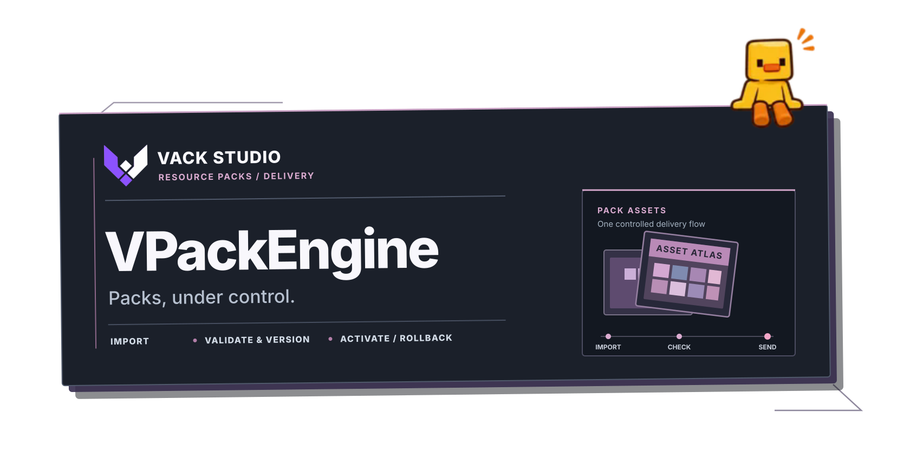
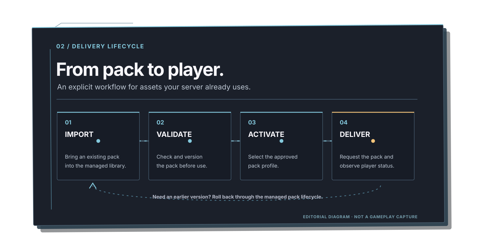
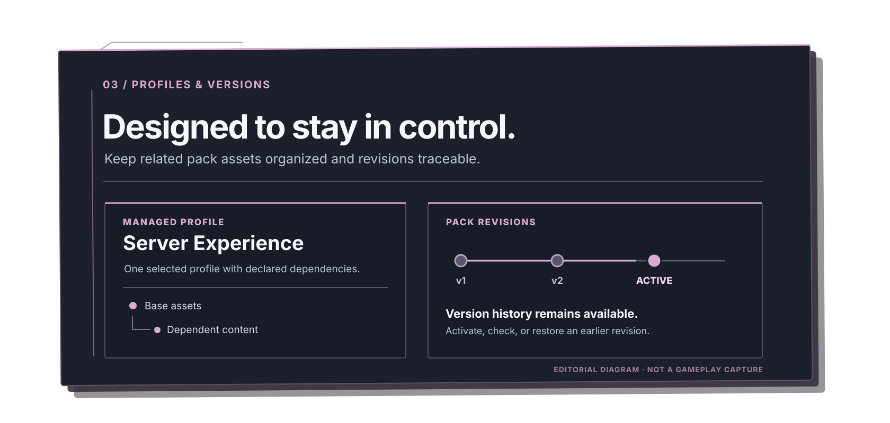
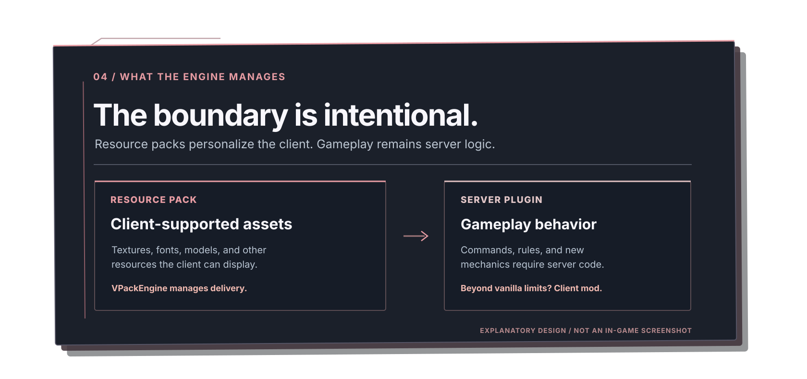
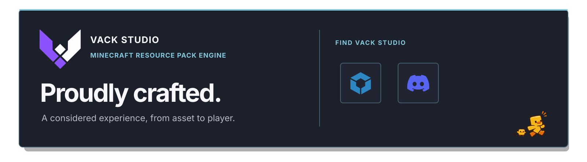

  

# VPackEngine 

**Packs, under control.**

A resource pack shapes the details players see. Keeping that experience consistent across updates, servers, and plugins takes more than moving files around.

**VPackEngine** is VACK STUDIO's resource-pack management layer for **Paper** servers. It organizes existing packs, tracks revisions and dependencies, activates approved profiles, and helps deliver the selected resources to players. Its public API also provides a foundation for add-ons building resource-driven inventory menus.

## From pack to player 

The lifecycle is deliberate: **bring a pack in, check it, choose what goes live, and observe delivery**. An earlier revision remains available when an update needs to be rolled back.

  

| Responsibility | What VPackEngine provides |
| :--- | :--- |
| **Pack lifecycle** | Import, validation, versions, activation, and rollback for existing resource packs |
| **Profiles & dependencies** | Organization of pack profiles and their declared dependencies |
| **Player delivery** | Requests for approved packs and status events for delivery |
| **Administrator tools** | Native administrator menus, resource bindings, and readiness checks |
| **Add-on integration** | A public API for plugins that use resource-driven inventory menus |

The engine manages the lifecycle and delivery of **existing** resource packs; it is not a texture generator or a gameplay framework.

## Keep the experience organized

Version history matters most when something changes. Profiles keep related resources together, and managed revisions let administrators work with a known pack instead of guessing which files are live.

  

The panel above is an **editorial diagram**, not a capture of the plugin's administrator interface.

## Example: updating a server pack 

Imagine refreshing the visual assets used by a server's menus. An administrator imports the prepared pack and checks it before activating the intended profile. VPackEngine then handles requests for the approved pack and exposes delivery status to integrations. If the update needs to be reverted, the managed pack lifecycle supports rolling back to an earlier revision.

This is an **illustrative workflow based on documented capabilities**, not an in-game recording or a promise that specific commands, presets, or integrations are available. The add-on creating the actual inventory-menu behavior remains a separate server-side implementation.

## Where the pack ends

  

Resource packs change assets supported by the Minecraft client. **New gameplay mechanics require server-side implementation**; behavior outside the vanilla client's resource-pack capabilities needs a client mod. VPackEngine does not automatically reconcile conflicting resources or create game mechanics.

<strong>Technical scope &amp; availability</strong>

- **Server platform:** Paper 26.2
- **Java runtime:** Java 25
- **Scope:** Management and player delivery of existing resource packs, including lifecycle, profiles, dependencies, and API events.
- **Source:** Maintained privately. This public repository is a project presentation, not a source-code or installable-JAR distribution.
- **Verification:** No runtime test results or supported-client compatibility matrix are provided in this public repository. Do not infer production acceptance from the illustrations.

Installation commands, required dependencies, and specific API signatures are intentionally omitted because they are not documented by the public project profile.

## Access & licensing

VPackEngine is proprietary VACK STUDIO software. Public visibility of this repository does **not** grant permission to use, redistribute, modify, or repackage private code or original project artwork. Authorized access is governed by a separate license or written agreement.

See [LICENSE](LICENSE) for the rights notice.

---

  

  
  &nbsp;&nbsp;&nbsp;&nbsp;
  

<strong>Artwork &amp; provenance</strong>

The first banner uses the **original V22 Mini Zoiila Edge Sitter** artwork already approved in VACK STUDIO's VAnimation presentation, without new AI-generated character art. The small Mini Zoiila section emojis are the original Vgtb PNG assets. The tiny Zoiila and Chick studio signature is an existing studio asset. Supporting diagrams are hand-authored SVG illustrations, not gameplay screenshots.

See [artwork provenance](assets/ARTWORK-PROVENANCE.md) for sources and scope. Third-party names and artwork remain the property of their respective owners.

Copyright © 2026 VACK STUDIO. All rights reserved.

